<!--

author:   Britta Petersen, Linda Zollitsch
email:    b.petersen@rz.uni-kiel.de
version:  0.1.0
language: de
narrator: 

icon:     images/Logo_cau-norm-de-lilagrey-rgb-0720_2022.png

licence: cc-by

title:  Einfürhung  in das Datenmanagement für technisch-administratives Personal.

link: https://raw.githubusercontent.com/RDM4CAU/Intro-to-RDM/refs/heads/main/cau-style.css

comment:  Einführungsworkshop zum Datenmanagement für technisch-administratives Personal (2h).

@style

.lia-slide__container {
    background-image: url("https://github.com/RDM4CAU/Demos/raw/main/Frauenvortragsmarathon2024/images/rdmCAU.png");
    background-size: 15%;
    background-repeat: no-repeat;
    background-position: right top;
    opacity: 1;
}

@end

-->

# Datenmanagement

> <font size="7"><div style="float: right">🗂️->💾</div></font>
>
> <font size="7">**Herzlich Willkommen!**</font>
>
> <font size="6">**Einführung  in das Datenmanagement für technisch-administratives Personal**</font><br><br>
> ***Britta Petersen & Linda Zollitsch***, [Zentrales Forschungsdatenmanagement](https://www.datamanagement.uni-kiel.de/de)

<div style="page-break-after: always;"></div>

## Ziele heute🎯

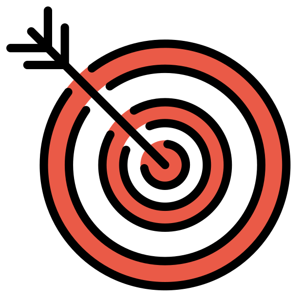

>**Wir möchten erreichen, dass Sie am Ende des Workshops ...**
>
>* ... einige Grundbegriffe und einige Vorgehensweisen beschreiben können, die für die Organisation von Daten hilfreich sind.
>* ... beschreiben können, weshalb ein gutes Management von Daten von Bedeutung ist.
>* ... über die eigene Rolle in den Prozessen des Datenmanagements diskutiert haben.
>* ... einige relevante Strukturen und Services der CAU nennen können.
>* ... mit anderen und uns über ihre Vorgehensweisen im Umgang mit Daten und über Ihre Unterstützungsbedarfe diskutiert haben.
>* ... auch ein bisschen Spaß hatten.

## Limitationen🚧


>**Es gibt viel zu erzählen und zu diskutieren, dennoch:**
>
>* Aus zeitlichen Gründen werden wir heute nur auf wenige Aspekte dessen, was es über Datenmanagement zu wissen gibt, eingehen können.
>
>* Berufsspezifische Aspekte sind nicht speziell vorgesehen, dürfen von Ihnen aber sehr gerne in die Diskussionen eingebracht werden.
>
>* Bitte haben Sie Nachsicht! Wir sind noch am Beginn eines Angebotsaufbaus für technisch-administratives Personal. Um unser Angebot auf Ihre Bedürfnisse zuschneiden zu können, brauchen wir Ihren Input!
>
>* Zum Ende des Workshops nehmen wir daher gerne Ihre Wünsche für diesen und für weiterführende/vertiefende Workshopthemen auf.

<div style="page-break-after: always;"></div>

## Agenda💪


>**Unsere Agenda für heute**
>
>- Ankommen: Workshop Regeln, Warm-up
>- Einstieg: Mit welchen Daten arbeiten Sie?
>- Datenmanagement? Was ist das und was soll das?
>- Was sind Forschungsdaten?
>- Daten ordnen und strukturieren
>- Services und Policies an der CAU (zu Forschungsdaten)
>- Diskussion und Ausklang

<div style="page-break-after: always;"></div>

# Einstieg 🤹
>***Wir würden gerne erfahren, mit welchen Daten und mit welchen Tools Sie hauptsächlich arbeiten und mit welchen Anliegen Sie in diesen Workshop gekommen sind.***

> **Lassen Sie uns kurz gemeinsam sammeln:**
>
>* Bereiche, in denen Sie tätig sind (z. B. Labor, Verwaltung)?
>* Daten und Tools, mit denen Sie beruflich umgehen.
>* Anliegen, die Sie in diesen Workshop mitbringen.
  
<div style="page-break-after: always;"></div>

# Datenmanagement?

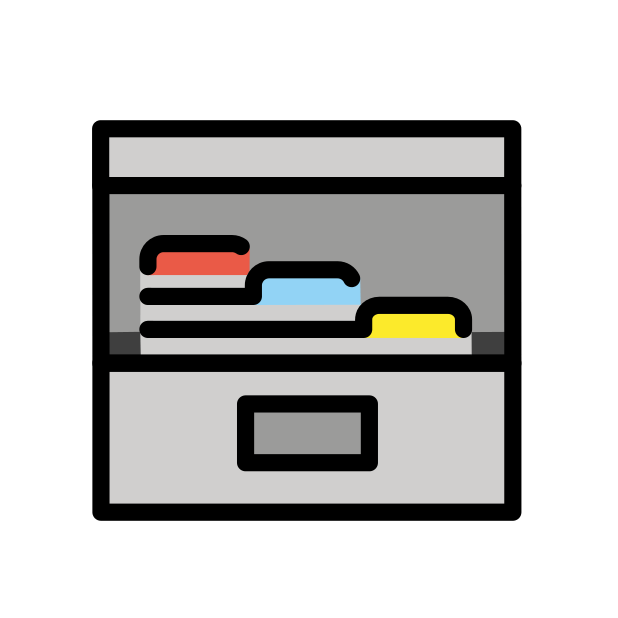

>**Was genau ist mit dem Begriff Datenmanagement gemeint?**
>
>**Was denken Sie? Welche Inhaltsaspekte gehören zum Datenmanagement?**

<div style="page-break-after: always;"></div>

## Begriffsdefinition Datenmanagement

{{0}}
********************************************************************************
>Datenmanagement beschäftigt sich mit Fragen zu den folgenden Themen:
>
> - Wie speichert man Daten?
> - Wo speichert man Daten?
> - Wie dokumentiert man Daten?
> - Wie organisiert man die Zusammenarbeit an Daten?
> - Wie bereitet man Daten auf?
> - Welche rechtlichen Aspekte sind ggf. zu beachten?
> - Welche ethischen Aspekte sind ggf. zu beachten?
>
>(https://www.forschungsdaten-bildung.de/daten-managen) 

********************************************************************************

{{1}}
********************************************************************************
>"Das Datenmanagement bezeichnet den gezielten Umgang mit Daten innerhalb einer Organisation oder Institution. Es umfasst die Planung, Organisation, Steuerung und Überwachung aller Prozesse, die für die Erfassung, Speicherung, Aufbereitung, Analyse und Nutzung von Daten erforderlich sind."
>
>(https://www.iph-hannover.de/de/dienstleistungen/data-science/datenmanagement/#:~:text=Das%20Datenmanagement%20bezeichnet%20den%20gezielten,Nutzung%20von%20Daten%20erforderlich%20sind.)

********************************************************************************

<div style="page-break-after: always;"></div>

## Begriffsdefinition Forschungsdaten


>An Hochschulen und Forschungseinrichtungen müssen wir "besondere" Daten managen: **Forschungsdaten**.
>
><font size="5">**Was sind Forschungsdaten?**</font>

{{1-2}}
********************************************************************************
Die **DFG** definiert den Begriff **"Forschungsdaten"** folgendermaßen:

> „Zu Forschungsdaten zählen u. a. Messdaten, Laborwerte, audiovisuelle Informationen, Texte, Surveydaten oder Beobachtungsdaten, methodische Testverfahren sowie Fragebögen. Korpora und Simulationen können ebenfalls zentrale Ergebnisse wissenschaftlicher Forschung darstellen und werden daher ebenfalls unter den Begriff Forschungsdaten gefasst. Da Forschungsdaten in einigen Fachbereichen auf der Analyse von Objekten basieren (z. B. Gewebe-, Material-, Gesteins-, Wasser- und Bodenproben, Prüfkörper, Installationen, Artefakte und Kunstgegenstände), muss der Umgang mit diesen ebenso sorgfältig sein und eine fachlich adäquate Nachnutzungsmöglichkeit, wann immer sinnvoll und möglich, mitgedacht werden. Ähnliches gilt, wenn Software für die Entstehung oder Verarbeitung von Forschungsdaten erforderlich ist.“
>
> (*DFG 2021*)

********************************************************************************

{{2}}
********************************************************************************

Etwas weniger kompliziert definierte das PrePARe Projekt der Camebridge University den Begriff **Forschungsdaten** als:

> “Any information you use in your research.”
>
> (*University of Cambridge PrePARe Project*)

********************************************************************************

<div style="page-break-after: always;"></div>

## Beiträge und Grenzen im FDM

>[!IMPORTANT] Wo sehen Sie Ihre Beiträge und Ihre Grenzen im Management von Forschungsdaten?

{{1}}
>**Typische Beiträge von technisch-administrativem oder Servicepersonal (z. B. Mitarbeitende im Bereich Sekretariat, Labor, IT, Bibliothek, Verwaltung, Projektmanagement) zum Forschungsdatenmanagement**
>
>🟢 Unterstützung bei Datenerzeugung, -erfassung und -ablage
>
>🟢 Etablierung von Arbeitsabläufen, Ordnerstrukturen und Dateibenennung  
>
>🟢 Sicherstellung von Dokumentationen und Übergaben  
>
>🟢 Hinweise auf Services, Policies, Fördereranforderungen, Templates, FAIR-Prinzipien, Metadaten, Repositorien  
>
>🟢 Sensibilisierung für gute Praxis und Qualitätsstandards
>
>**Nicht Teil Ihrer Verantwortung**
>
>🔴 Wissenschaftliche Interpretation und Bewertung von Daten  
>
>🔴 Entscheidungen über Forschungsdesign, Methodik oder Publikationen  
>
>🔴 Alleinige rechtliche Verantwortung für Datennutzung oder Ergebnisse
>
>>**Ihr Beitrag schafft verlässliche Rahmenbedingungen – die wissenschaftliche Verantwortung bleibt bei den Forschenden.**

<div style="page-break-after: always;"></div>

## Policies der CAU zu Forschungsdaten

{{0-1}}
****************
>Relevante Leitlinien oder Policies sollten bekannt sein und in jedem DMP genannt werden.
>
>**Sind relevante Leitlinien der CAU bekannt?**

****************

{{1}}
****************
**Relevante Leitlinien der CAU:**

- [Leitlinie zum Umgang mit Forschungsdaten](https://www.datamanagement.uni-kiel.de/de/forschungsdatenmanagement-an-der-cau/leitlinie-zum-umgang-mit-forschungsdaten)

- [Leitlinien zur Förderung von Open Access](https://www.datamanagement.uni-kiel.de/de/forschungsdatenmanagement-an-der-cau/leitlinien-zur-forderung-von-open-access)

- [Richtlinien der CAU zur Sicherung guter wissenschaftlicher Praxis](https://www.uni-kiel.de/fileadmin/user_upload/forschung/integritaet-ethik/downloads/Richtlinien-Sicherung-guter-wissenschaftlicher-Praxis.pdf)

****************

<div style="page-break-after: always;"></div>

# FAIR-Prinzipien

<big>
>Ziel eines guten Forschungsdatenmanagements ist es, Forschungsdaten so zu organisieren und zu dokumentieren, dass sie möglichst langfristig auffindbar, zugänglich, interoperabel und nachnutzbar bleiben – unabhängig davon, wer ursprünglich mit ihnen gearbeitet hat.
</big>

{{0-1}}
********************************************************************************
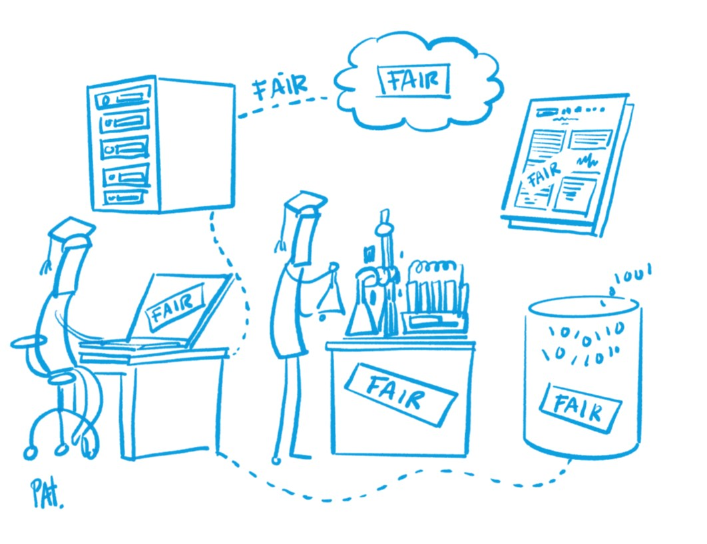

><font size="5">**Die [FAIR-Prinzipien](https://www.nature.com/articles/sdata201618) dienen in Bezug auf das Management von Forschungsdaten als Leitprinzipien!**</font>
<br>
<br>
<br>
<br>
<br>
<br>
<br>
<br>
<br>
<br>
<small>Illustration: Patrick Hochstenbach in [Engelhardt, Claudia et. al. (2021)](https://univerlag.uni-goettingen.de/bitstream/handle/3/isbn-978-3-86395-539-7/Engelhardt_FAIR.pdf?sequence=1&).</small>
********************************************************************************

{{1}}
>**F**indable

{{2-3}}
****************
Daten sollten sowohl für Menschen als auch für Computer möglichst leicht zu finden sein.

Auffindbarkeit wird z. B. unterstützt durch:

- strukturierte Ablagen
- Benennungskonventionen
- PIDs

***************

{{1}}
>**A**ccessible

{{3-4}}
***********************
Es sollte immer klar beschrieben sein, wie auf Daten zugegriffen werden kann, einschließlich Authentifizierung (Identifikation) und Autorisierung (Zugriffs- und Bearbeitungsrechte).

******************

{{1}}
>**I**nteroperable

{{4-5}}
**********************
Daten sollten in einer Form vorliegen und dokumentiert sein, die die Nutzung mit diversen Anwendungen oder Arbeitsabläufen für Speicherung und Verarbeitung ermöglichen.

- Dateiformate
- Verwendung von Standards (z. B. Metadaten, Vokabulare)

**********************

{{1}}
>**R**eusable

{{5-6}}
***************
Um die Wiederverwendung von Daten möglich zu machen und zu optimieren müssen Daten gut beschrieben und von Dokumentationen ergänzt werden.

Eine Angabe bzgl. der Nutzungsbedingungen (z. B. Lizenzen) sollte vorliegen.

**************

<div style="page-break-after: always;"></div>


# Daten ordnen und strukturieren

{{0-1}}
********************************************************************************
<div style="text-align:center">
><p style="color:#9a047f">**Es mag banal erscheinen, aber eine strukturierte Ordner- und Dateibenennung ist ein wichtiger Schritt im Datenmanagement!**</p>
</div>

<center>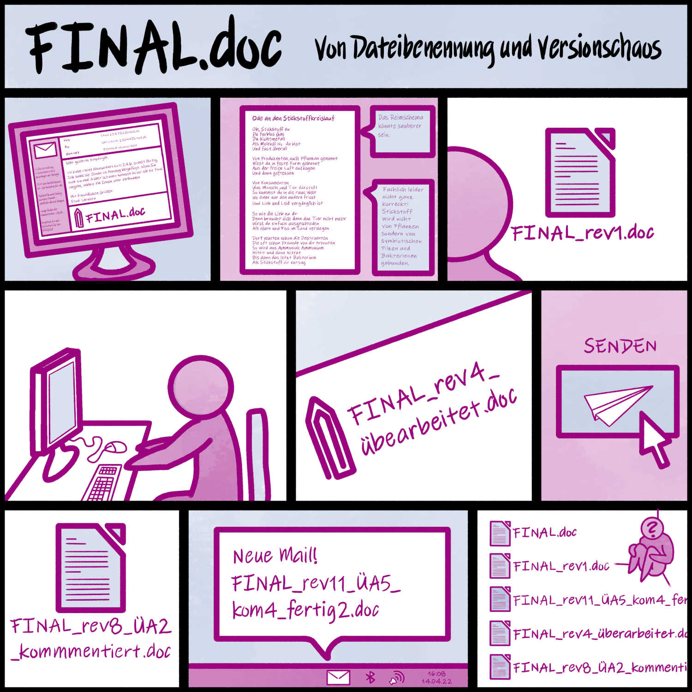</center>

<div style="text-align:center">
<P><SMALL>Illustration: Cleo Michelsen</SMALL></P>
</div>

********************************************************************************

{{1-2}}
********************************************************************************
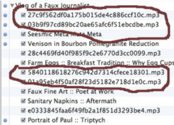

* Haben Sie sich schon mal über sich selbst geärgert, weil Sie bestimmte Dateien nicht oder nur mit großem Aufwand finden konnten?

* Sind Ihnen vielleicht sogar schon mal Daten verloren gegangen, weil Dateien versehentlich überschrieben wurden?

* Gibt es in Ihrem Arbeitsbereich Regeln bzgl. der Benennung von Ordnern und Dateien?

********************************************************************************

{{2}}
********************************************************************************
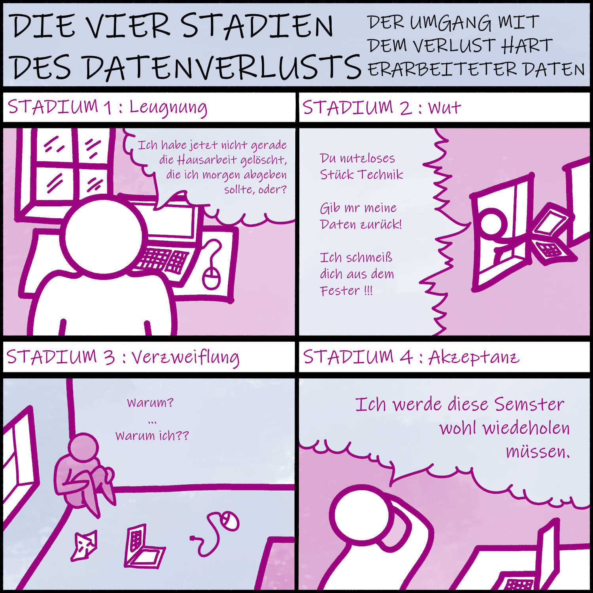

Ordner und Dateien sollten systematisch benannt und geordnet sein, damit

* die Dateien jetzt und in Zukunft leicht auffindbar und zugänglich sind,
* längeres Suchen von Dateien oder das Vergleichen verschiedener Versionen von Dateien vermieden wird,
* Änderungen nachvollziehbar sind,
* die Dateien nicht versehentlich gelöscht oder überschrieben werden,
* um die Zusammenarbeit zu verbessern und
* Automatisierungsprozesse zu ermöglichen.

********************************************************************************

<div style="page-break-after: always;"></div>

## Ordnerstrukturen

<!-- style="width: 15%; float:right" -->


Eine hierarchische Ordnerstruktur entwickeln
---

{{1-2}}
*************************

<!-- style="font-size: 20px;" -->
>[!IMPORTANT] Regel Nr. 1: So früh, wie möglich (in einem Projektverlauf) eine logische Struktur mit klaren Hauptkategorien für Dateiordner angelegen!

*************************

{{2-3}}
*************************

2. Ordner fassen Dateien mit gemeinsamen Eigenschaften zusammen, d. h. Sie müssen

- Attribute definieren, nach denen Dateien kategorisierbar sind, z. B.:

  - Lehrstuhl
  - Projekt
  - Finanzen
  - Zeit (Jahre, Monate)
  - Ort
  - Bearbeitungsstatus
  - ...?

*************************

{{3-4}}
*************************

<!-- style="width: 80%; float:left" -->
``` ascii
01_Lehrstuhl-A
     |
     ├── 01_Administration (z. B. Verträge, Personal, Finanzen)
     │   
     ├── 02_Projekte (z. B. Projekt A, Projekt B)
     │   
     ├── 03_Lehre (z. B. Veranstaltungen, TN-Verwaltung)
     │
     ├── ...     
     │    
     ├── 99_Zwischenablage
     │   
     └── README.md (erklärt die Ordnerstruktur und die Benennungsregeln für Dateien.)
```

*************************

{{4-5}}
*************************

3. Unterordner nach Bedarf angelegen. Dabei beachten:

- Nicht zu viele Unterordner anlegen. Pfade werden lang!

   -> Daumenregel für die Ordnerstruktur eine Ablagesystematik mit maximal vier Ebenen und höchstens zehn Ordnern pro Ebene

- Überlegen Sie, welche Attribute Ihnen für die Sortierung am wichtigsten erscheinen. Entwickeln Sie Ihre Hierarchie entsprechend.

<br>

<!-- style="width: 45%; float:left" -->
``` ascii

Sortierung erst nach Jahren, dann nach Orten

Projekt XYZ
     :
     │   
     ├── Veranstaltungen
     │   └──── 2023
     │   └──── 2024
     │   └──── 2025
     │           └──── Flensburg
     │           └──── KIel     
     :
     └── README.md
```


<!-- style="width: 45%; float:right" -->
``` ascii
Sortierung erst nach Orten, dann nach Jahren

Projekt XYZ
     :
     │   
     ├── Veranstaltungen
     │   └──── Flensburg
     │   └──── Kiel
     │           └──── 2023
     │           └──── 2024  
     :
     └── README.md
```
*************************

{{5-9}}
4. Laufende und abgeschlossene Arbeiten werden getrennt
{{6-9}}
5. Wenn es um Forschungsdaten geht: Rohdaten werden gesondert abgelegt!
{{7-9}}
6. Es gibt eine Zwischenablage, die regelmäßig aufgeräumt wird -->
{{8-9}}
7. Nicht mehr benötigte Dateien werden regelmäßig gelöscht (Intervalle festlegen!)


{{9-10}}
********************************************************************************

---

Es gilt außerdem:

* Immer zunächst prüfen, ob bereits etablierte Strukturen existieren!
* Ausprobieren und anpassen!
* Dokumentieren und Dokumentation bei Änderungen anpassen!
* Für gemeinsam genutzte Dateien gemeinsame Regeln festlegen!
* Konsequent bleiben!

********************************************************************************

<div style="page-break-after: always;"></div>

## Dateibenennung

Die Art und Weise der Benennung von Dateien ist ein wichtiger Baustein im Datenmanagement.

Folgende Punkte können bei der Erstellung (nachvollziehbarer) Dateinamen helfen:

{{1-9}}
* Möglichst nicht mehr als 32 Zeichen für Dateinamen benutzen.
{{2-9}}
* Grundsätzlich keine unspezifischen Dateinamen (z. B.untitled3746.csv) verwenden.
{{3-9}}
* Dateinamen in Namensbestandteilen festlegen, Art der Trennung und Reihenfolge der Namensbestandteile konsequent beibehalten (z.B Datum\_Veranstaltungstitel\_Teilnehmende.extension)
{{4-9}}
* Möglichst keine Sonderzeichen, Umlaute oder Leerzeichen in Dateinamen benutzen.
{{5-9}}
* Einzig erlaubte Sonderzeichen sind Unterstrich ( _ ) und Bindestrich ( - ).
{{6-9}}
* Führende Null(en) bei Nummerierungen verwenden.
{{7-9}}
* Datumsangaben nach der ISO 8601 (YYYYMMDD oder YYYY-MM-DD oder YYYY\_MM\_DD).
{{8-9}}
* Keine unspezifischen Namensanhänge, wie \_final, \_neu, \_fertig o. ä. verwenden!

---

{{9-10}}
********************************************************************************

**Es gilt außerdem:**

* Prüfen, ob bereits etablierte Dateibenennungskonventionen existieren.
* Eigene Benennungsregeln in Form einer Dateibenennungskonvention festlegen und dokumentieren.
* Dokumentation der Ordnerstrukturen und Benennungskonventionen inkl. genutzter Abkürzungen u. ä. in einer README-Datei
* Konventionen möglichst frühzeitig festlegen
* Unterschiedliche Konventionen für verschiedene Dateitypen sind erlaubt.
* Dokumentieren/Dokumentation bei Änderungen anpassen

********************************************************************************

{{10}}
********************************************************************************
Beispiele für Benennungskonventionen:

<!-- style="width:120%" -->
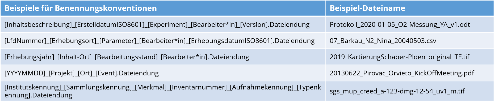

********************************************************************************

<div style="page-break-after: always;"></div>

## Versionierung

{{0-1}}
********************************************************************************

>* Um verschiedene Stadien der Bearbeitung von Dateien nachvollziehen und unterscheiden zu können, sollte eine konsequente Versionierung vorgenommen werden.
>
>* Das Vorgehen bei der Versionierung sollte allen Beteiligten bekannt sein.
>
>* Versionierungen können im Dateinamen vorgenommen werden und die Vorgehensweise gemeinsam mit der Dokumentation zu Ordnerstruktur und Dateibenennung in der README-Datei dokumentiert werden.
>
>* In einer **Versionskontrolltabelle** kann eine Dokumentation der vorgenommenen Änderungen erfolgen.

********************************************************************************

{{1-2}}
********************************************************************************

**Versionierung im Dateinamen:**

Die Versionierung kann Bestandteil des Dateinamens sein.  Dabei kann zwischen größeren und kleineren Änderungen unterschieden werden:

* größere Änderungen = Beispieldatei\_v1 -> Beispieldatei_v2
* kleinere Änderungen = Beispieldatei\_v1-1 -> Beispieldatei\_v1-2

=> Beschreiben Sie in einer README, was für Sie als größere bzw. kleinere Änderung gilt.

><p style="color:#9a047f">**Unspezifische Bezeichnungen vermeiden!**</p>
>
>* ~original1~
>* ~neu~
>* ~bearbeitung2~
>* ~final~
>* ~final_2~


********************************************************************************

{{2-3}}
********************************************************************************

**Beispiel für eine Versionskontrolltabelle**

| Versionsnr.  | Änderungen                       | Datum      | Bearbeitung durch |
| :----------  | :----------                      | ---        | ---               |
| 1-0          | Freigabe                         | 2023-11-02  | KL                |
| 1-1          | Verbesserung Rechtschreibfehler  | 2023-11-20 | KL                |
| 1-2          | Änderungen am Layout             | 2024-02-20 | GN                |
| 2-0          | Neues Kapitel (3.1) hinzugefügt | 2024-02-26 | GN                |

Eine Versionskontrolltabelle kann innerhalb des bearbeiteten Dokuments oder als separate Datei angelegt werden.

********************************************************************************

<div style="page-break-after: always;"></div>

## README-Dateien

>**README-Dateien sind wichtige Dokumentationsinstrumente!**
>
>Eine gute README
>
>- reduziert Rückfragen
>- erleichtert Übergaben  
>- schafft Transparenz über Strukturen und Zuständigkeiten
>
>Regeln für das Anlegen von Ordnern, Namenskonventionen und Versionierungen sollten in einer **README-Datei** dokumentiert werden, die als einfache Textdatei (z. B.: .md, .txt) auf der ersten hierarchischen Ebene der jeweiligen Ordnerstruktur abgelegt wird.

### Beispiel README

>Eine solche README-Datei könnte z.B. so aussehen:

<div style="float:left; width:85%;">

```markdown
# ALLGEMEINES
Projekt/Arbeitsbereich: [Bezeichnung]
Erstellt am: [Datum]
Verantwortlich: [Name]
Beteiligte: [Namen]

Beschreibung:
[Kurze Beschreibung des Projekts, Arbeitsbereichs oder der Daten]

Relevante Links:
- Univis:
- OpenOlat:
- CAUGitLab:
- FIS:

# Ordnerstruktur
Dateien werden in einer klaren, hierarchischen Struktur abgelegt.

Beispiel:
- 01_Projektname
  - 01_Administration
  - 02_Projekte
  - 03_Lehre
  - 99_Zwischenablage
  - README.md

- Rohdaten werden getrennt von verarbeiteten Daten gespeichert.
- Laufende und abgeschlossene Arbeiten werden getrennt aufbewahrt.

# Dateibenennung
Dateinamen sollen nachvollziehbar, kurz und konsistent sein.

Regeln:
- Keine Leerzeichen, Umlaute oder Sonderzeichen
- Nur Unterstrich (_) und Bindestrich (-)
- Datumsformat: YYYYMMDD oder YYYY-MM-DD
- Keine generischen Namen wie final, neu, bearbeitet, original
- Einfache, sprechende Namen 
- Abkürzungen dokumentieren!

Beispiele:
- 20250122_ProjektA_Meeting_v1.pdf
- 20250122_ProjektA_Rohdaten.csv
- 20250122_ProjektA_Analyse_v2.xlsx

# Versionierung
Versionierung erfolgt im Dateinamen.

Beispiele:
- v1, v2
- v1-1, v1-2

Wichtig:
- Großere Änderungen: hier beschreiben, was eine neue Version (z. B. v2) rechtfertigt
- Kleinere Änderungen: hier beschreiben, was eine kleine Änderung ist und Verionssprung auf (z. B. v1-1) rechtfertigt
- Änderungen dokumentieren und bei Bedarf in einer Versionskonrolltabelle festhalten

# Speicherung & Backup
Speicherorte, Zugriffsrechte und Backups erfolgen nach den geltenden Vorgaben der CAU und den Anforderungen des Projekts.

Beispiel:
- Speicherung auf [lokalem Server/Share/Cloud]
- Backup: [täglich/wöchentlich]
- Aufbewahrung: [Zeitraum/Ort]

# Letzte Änderungen
| Datum | Änderung | Verantwortlich |
|------|---------|----------------|
| [Datum] | [Änderung] | [Name] |

```
</div>

<div style="page-break-after: always;"></div>

## Zeit für Austausch

>**Gruppenarbeit**
>
>Tauschen Sie sich in Ihren Gruppen zum aktuellen Vorgehen bzgl. Datenmanagement in Ihren jeweiligen Tätigkeitsbereichen aus.
>
>- Existieren in Ihrem Bereich Konventionen zum Umgang mit Daten (z. B. zur Benennung) und/oder bestimmte Routinen, wie z. B. regelmäßiges Aufräumen/Sortieren oder Löschen von Dateien?
>- Welche positiven Erfahrungen können Sie teilen, wie im Arbeitsalltag eine ordentliche und übersichtliche Struktur von Dateien effektiv beibehalten werden kann?

>**Ganz generell**: Wenn Sie an das Handling von Daten in Ihrem jeweiligen Tätigkeitsbereich denken:
>- An welchen Stellen wünschen sich Kolleg:innen oder Forschende Unterstützung von Ihnen?
>- Wo ziehen Sie bewusst eine Grenze und verweisen weiter?

<div style="page-break-after: always;"></div>

# Wrap Up

>**Forschungsdatenmanagement im Blick: Was sollte ich beachten?**
>
>>**Dateien und Ablagestrukturen**
>>- Gibt es nachvollziehbare Ablagestrukturen?
>>- Wissen alle Beteiligten, wo Daten zu finden sind?
>
>>**Dokumentation und Übergaben**
>>- Können Kolleg:innen Dateien und Daten auch ohne zusätzliche Erklärungen verstehen?
>>- Sind Zuständigkeiten und Arbeitsabläufe dokumentiert?
>
>>**Speicherung und Zugriff**
>>- Werden geeignete Speicherorte und Backups verwendet?
>>- Sind Zugriffsrechte und Datenschutz berücksichtigt?
>
>>**Unterstützungsbedarf**
>>- Gibt es Fragen, bei denen an eine zuständige Stelle verwiesen werden sollte?

# FDM@CAU ✨
<div style="float:right; width:40%;">
  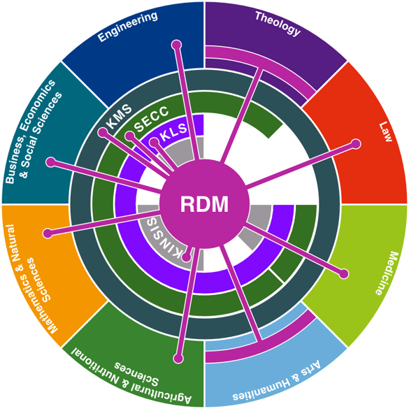
</div>

**Forschungsdatenmanagement ist keine Aufgabe, die man alleine macht!**

Das **Zentrale Forschungsdatenmanagement** der CAU besteht aus Mitarbeitenden des Rechenzentrums und der Universitätsbibliothek.

Gemeinsam arbeiten, beraten und unterstützen wir zum Thema.

**Zentrales Forschungsdatenmanagement**

- Kolleg:innen aus RZ und UB für Themen aus FDM, DH, IT und Didaktik

- Entwicklung und Bereitstellung grundlegender Services für FAIR and Open Data

- Beratung und Schulungen für Forschende

- Praktische Unterstützung bei der Realisierung von FDM-Lösungen 

- Didaktische Beratung & Begleitung der Integration von FDM in die curriculare Lehre

- Einrichtung und Betrieb eines institutionellen Datenrepositoriums [opendata@uni-kiel](https://opendata.uni-kiel.de/content/index.xml)

Kontakte und Informationen zum FDM an der CAU finden Sie hier: https://www.fdm.uni-kiel.de/

<div style="page-break-after: always;"></div>

## Datenschutz🦺

<iframe src="https://www.uni-kiel.de/gf-praesidium/de/recht/datenschutz-1" style="border:0px;width:100%;height:500px" allowfullscreen="true" webkitallowfullscreen="true" mozallowfullscreen="true"></iframe>

https://www.uni-kiel.de/gf-praesidium/de/recht/datenschutz-1

<div style="page-break-after: always;"></div>

## Opendata@CAU 🔓

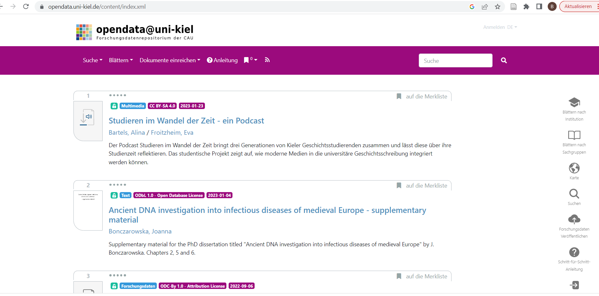

https://opendata.uni-kiel.de/content/index.xml

Testsystem zum Ausprobieren: https://datenrepositorium00.rz.uni-kiel.de

<div style="page-break-after: always;"></div>

## MACAU 📝

<iframe src="https://macau.uni-kiel.de/content/index.xml" style="border:0px;width:100%;height:500px" allowfullscreen="true" webkitallowfullscreen="true" mozallowfullscreen="true"></iframe>

https://macau.uni-kiel.de/content/index.xml

<div style="page-break-after: always;"></div>

## IGSN Dienst 🍃

<iframe src="https://igsn.uni-kiel.de/de" style="border:0px;width:100%;height:500px" allowfullscreen="true" webkitallowfullscreen="true" mozallowfullscreen="true"></iframe>

https://igsn.uni-kiel.de/de

<div style="page-break-after: always;"></div>

## Literaturverwaltung 📚

{{0}}
***
Das Rechenzentrum stellt eine Citavi-Campuslizenz zur Verfügung:

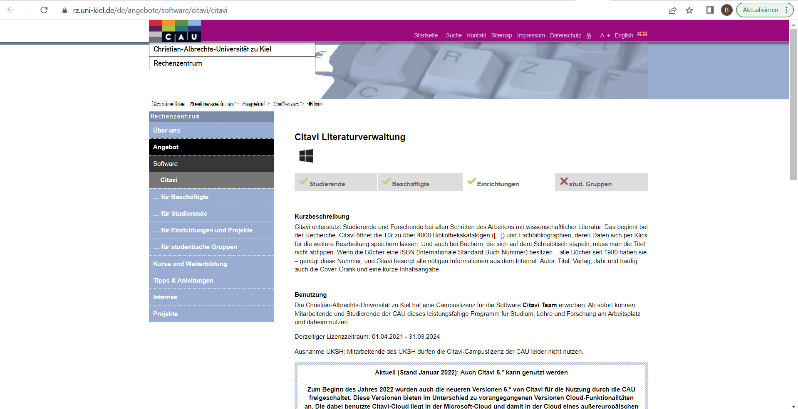

https://www.rz.uni-kiel.de/de/angebote/software/citavi/citavi

***

{{1}}
***
An der Universitätsbibliothek finden Sie Kurse zur Literaturverwaltung sowie verschiedenes Selbstlernmaterial:

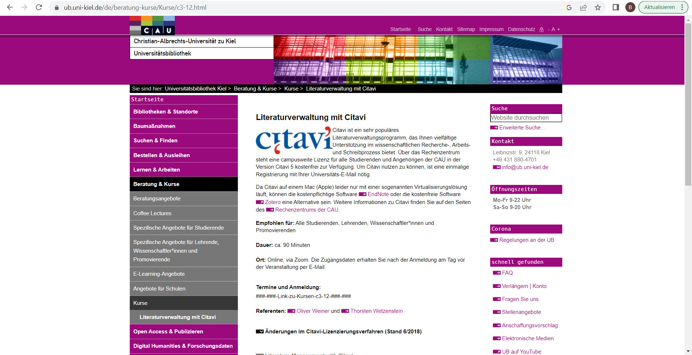

https://www.ub.uni-kiel.de/de/kurse

***

<div style="page-break-after: always;"></div>

## FIS 🔦

<iframe src="https://www.fis.uni-kiel.de/de" style="border:0px;width:100%;height:500px" allowfullscreen="true" webkitallowfullscreen="true" mozallowfullscreen="true"></iframe>

# Feedback

{{0-1}}
********************************************************************************

>Fast geschafft!
>
>Haben Sie noch Fragen oder Anmerkungen?

********************************************************************************

{{1-2}}
********************************************************************************

> <!-- width="100px" align="right" -->
>
>Sie haben heute Abend noch eine Verabredung mit einigen Freunden. Ihre Freunde erinnern sich daran, dass Sie heute an einem Workshop zum Thema Datenmanagement teilgenommen haben und fragen: "Na, wie war's"?
>
>Was antworten Sie?

********************************************************************************

{{2}}
********************************************************************************
Das Team FDM der CAU finden Sie hier: https://www.fdm.uni-kiel.de/de


********************************************************************************
<div style="page-break-after: always;"></div>

# Informationen zu diesem Dokument

| Parameter           | Info                       |
| --------            | :------                   |
| Titel:              | @title                     |
| Einsatz:            | @comment                   |
| Autor:innen         | @author                    |
| Lizenz              | @licence                   |
| Link zum Repository:| https://github.com/RDM4CAU |      
