<!--

author:   Britta Petersen, Linda Zollitsch
email:    b.petersen@rz.uni-kiel.de
version:  0.1.0
language: de
narrator: 

icon:     images/Logo_cau-norm-de-lilagrey-rgb-0720_2022.png

licence: cc-by

title:  Einführung in das Datenmanagement für technisch-administratives Personal.

link: https://raw.githubusercontent.com/RDM4CAU/Intro-to-RDM/refs/heads/main/cau-style.css

comment:  Einführungsworkshop zum Datenmanagement für technisch-administratives Personal (2h).

@style

.lia-slide__container {
    background-image: url("https://github.com/RDM4CAU/Demos/raw/main/Frauenvortragsmarathon2024/images/rdmCAU.png");
    background-size: 15%;
    background-repeat: no-repeat;
    background-position: right top;
    opacity: 1;
}

@end

-->

# Datenmanagement

> <font size="7"><div style="float: right">🗂️->💾</div></font>
>
> <font size="7">**Herzlich Willkommen!**</font>
>
> <font size="6">**Einführung in das Datenmanagement für technisch-administratives Personal**</font><br><br>
> ***Britta Petersen & Linda Zollitsch***, [Zentrales Forschungsdatenmanagement](https://www.datamanagement.uni-kiel.de/de)

<div style="page-break-after: always;"></div>

## Ziele heute🎯

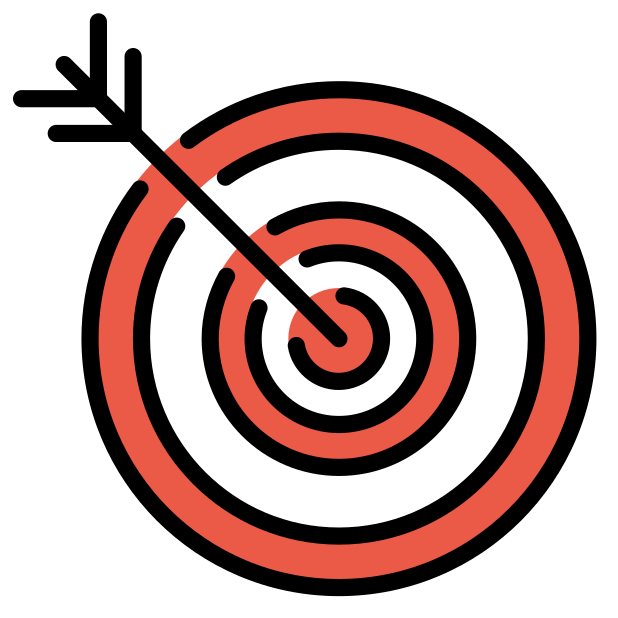

>**Wir möchten erreichen, dass Sie am Ende des Workshops ...**
>
>* ... einige Grundbegriffe und einige Vorgehensweisen beschreiben können, die für die Organisation von Daten hilfreich sind.
>* ... beschreiben können, weshalb ein gutes Management von Daten von Bedeutung ist.
>* ... über die eigene Rolle in den Prozessen des Datenmanagements diskutiert haben.
>* ... einige relevante Strukturen und Services der CAU nennen können.
>* ... mit anderen und uns über ihre Vorgehensweisen im Umgang mit Daten und über Ihre Unterstützungsbedarfe diskutiert haben.
>* ... auch ein bisschen Spaß hatten.


## Limitationen🚧


>**Es gibt viel zu erzählen und zu diskutieren, dennoch:**
>
>* Aus zeitlichen Gründen werden wir heute nur auf wenige Aspekte dessen, was es über Datenmanagement zu wissen gibt, eingehen können.
>
>* Berufsspezifische Aspekte sind nicht speziell vorgesehen, dürfen von Ihnen aber sehr gerne in die Diskussionen eingebracht werden.
>
>* Bitte haben Sie Nachsicht! Wir sind noch am Beginn eines Angebotsaufbaus für technisch-administratives Personal. Um unser Angebot auf Ihre Bedürfnisse zuschneiden zu können, brauchen wir Ihren Input!
>
>* Zum Ende des Workshops nehmen wir daher gerne Ihre Wünsche für diesen und für weiterführende/vertiefende Workshopthemen auf.

<div style="page-break-after: always;"></div>

## Agenda💪


>**Unsere Agenda für heute**
>
>- Ankommen: Workshop Regeln, Warm-up
>- Einstieg: Mit welchen Daten arbeiten Sie?
>- Datenmanagement? Was ist das und was soll das?
>- Forschungsdaten und Forschungsförderer
>- Daten ordnen und strukturieren
>- Services und Policies an der CAU (zu Forschungsdaten)
>- Diskussion und Ausklang

<div style="page-break-after: always;"></div>

# Einstieg 🤹
>***Wir würden gerne erfahren, mit welchen Daten und mit welchen Tools Sie hauptsächlich arbeiten und mit welchen Anliegen Sie in diesen Workshop gekommen sind.***

> **Lassen Sie uns kurz gemeinsam sammeln:**
>
>* Bereiche, in denen Sie tätig sind (z. B. Labor, Verwaltung)?
>* Daten und Tools, mit denen Sie beruflich umgehen.
>* Anliegen, die Sie in diesen Workshop mitbringen.
  
<div style="page-break-after: always;"></div>

# Datenmanagement?

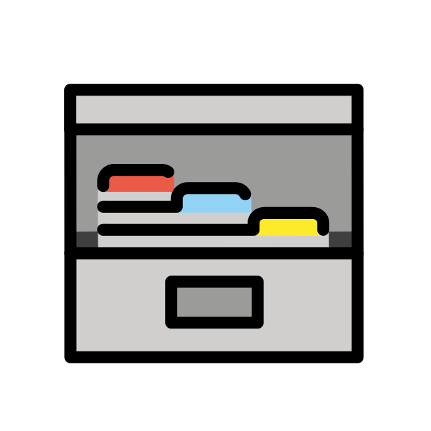

>**Was genau ist mit dem Begriff Datenmanagement gemeint?**
>
>**Welche Inhaltsaspekte gehören eigentlich dazu?**
>
>**Was denken Sie? Welche Inhaltsaspekte gehören zum Datenmanagement?**

<div style="page-break-after: always;"></div>

## Begriffsdefinition Datenmanagement

{{0}}
********************************************************************************
>Datenmanagement beschäftigt sich mit Fragen zu den folgenden Themen:
>
> - Wie speichert man Daten?
> - Wo speichert man Daten?
> - Wie dokumentiert man Daten?
> - Wie organisiert man die Zusammenarbeit an Daten?
> - Wie bereitet man Daten auf?
> - Welche rechtlichen Aspekte sind ggf. zu beachten?
> - Welche ethischen Aspekte sind ggf. zu beachten?
>
>(https://www.forschungsdaten-bildung.de/daten-managen) 

********************************************************************************

{{1}}
********************************************************************************
>"Das Datenmanagement bezeichnet den gezielten Umgang mit Daten innerhalb einer Organisation oder Institution. Es umfasst die Planung, Organisation, Steuerung und Überwachung aller Prozesse, die für die Erfassung, Speicherung, Aufbereitung, Analyse und Nutzung von Daten erforderlich sind."
>
>(https://www.iph-hannover.de/de/dienstleistungen/data-science/datenmanagement/#:~:text=Das%20Datenmanagement%20bezeichnet%20den%20gezielten,Nutzung%20von%20Daten%20erforderlich%20sind.)

********************************************************************************

<div style="page-break-after: always;"></div>

## Begriffsdefinition Forschungsdaten


>An Hochschulen und Forschungseinrichtungen müssen wir "besondere" Daten managen: **Forschungsdaten**.
>
><font size="5">**Was sind Forschungsdaten?**</font>

{{1-2}}
********************************************************************************
Die **DFG** definiert den Begriff **"Forschungsdaten"** folgendermaßen:

> „Zu Forschungsdaten zählen u. a. Messdaten, Laborwerte, audiovisuelle Informationen, Texte, Surveydaten oder Beobachtungsdaten, methodische Testverfahren sowie Fragebögen. Korpora und Simulationen können ebenfalls zentrale Ergebnisse wissenschaftlicher Forschung darstellen und werden daher ebenfalls unter den Begriff Forschungsdaten gefasst. Da Forschungsdaten in einigen Fachbereichen auf der Analyse von Objekten basieren (z. B. Gewebe-, Material-, Gesteins-, Wasser- und Bodenproben, Prüfkörper, Installationen, Artefakte und Kunstgegenstände), muss der Umgang mit diesen ebenso sorgfältig sein und eine fachlich adäquate Nachnutzungsmöglichkeit, wann immer sinnvoll und möglich, mitgedacht werden. Ähnliches gilt, wenn Software für die Entstehung oder Verarbeitung von Forschungsdaten erforderlich ist.“
>
> (*DFG 2021*)

********************************************************************************

{{2}}
********************************************************************************

Etwas weniger kompliziert definierte das PrePARe Projekt der Camebridge University den Begriff **Forschungsdaten** als:

> “Any any information you use in your research.”
>
> (*University of Camebridge PrePARe Project*)

********************************************************************************

<div style="page-break-after: always;"></div>


### Beiträge und Grenzen

>**Typische Beiträge von Servicepersonal (Labor, IT, Bibliothek, Verwaltung, Projektassistenz, Data Stewards) zum Forschungsdatenmanagement**
>
>🟢 Unterstützung bei Datenerzeugung, -erfassung und -ablage
>
>🟢 Etablierung von Arbeitsabläufen, Ordnerstrukturen und Dateibenennung  
>
>🟢 Sicherstellung von Dokumentationen und Übergaben  
>
>🟢 Hinweise auf Policies, Fördereranforderungem, Templates, FAIR-Prinzipien, Metadaten, Repositorien  
>
>🟢 Sensibilisierung für gute Praxis und Qualitätsstandards
>
>**Nicht Teil Ihrer Verantwortung**
>
>🔴 Wissenschaftliche Interpretation und Bewertung von Daten  
>
>🔴 Entscheidungen über Forschungsdesign, Methodik oder Publikationen  
>
>🔴 Rechtliche Verantwortung für Datennutzung oder Ergebnisse
>

>**Ihr Beitrag schafft verlässliche Rahmenbedingungen – die wissenschaftliche Verantwortung bleibt bei den Forschenden.**

<div style="page-break-after: always;"></div>


# FAIR-Prinzipien

>Das **Ziel** im Umgang mit (Forschungs)Daten ist es, Daten **langfristig** und **personenunabhängig** ~~zugänglich~~, ~~nachnutzbar~~ und ~~nachprüfbar~~ zu halten.

{{0-1}}
********************************************************************************
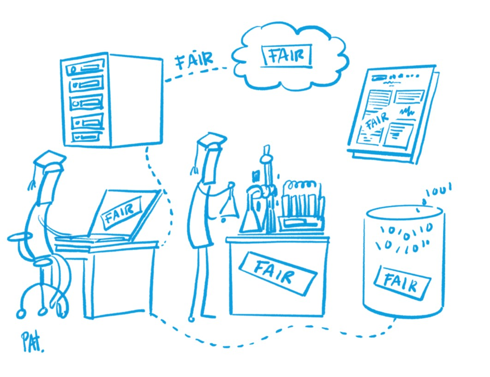

><font size="5">**Die [FAIR-Prinzipien](https://www.nature.com/articles/sdata201618) dienen in Bezug auf das Management von Forschungsdaten als Leitprinzipien!**</font>
<br>
<br>
<br>
<br>
<br>
<br>
<br>
<br>
<br>
<br>
<small>Illustration: Patrick Hochstenbach in [Engelhardt, Claudia et. al. (2021)](https://univerlag.uni-goettingen.de/bitstream/handle/3/isbn-978-3-86395-539-7/Engelhardt_FAIR.pdf?sequence=1&).</small>
********************************************************************************

{{1}}
>**F**indable

{{2-3}}
****************
Daten sollten sowohl für Menschen als auch für Computer möglichst leicht zu finden sein.

Auffindbarkeit wird z. B. unterstützt durch:

- strukturierte Ablagen
- Benennungskonventionen
- PIDs

***************

{{1}}
>**A**ccessible

{{3-4}}
***********************
Es sollte immer klar beschrieben sein, wie auf Daten zugegriffen werden kann, einschließlich Authentifizierung (Identifikation) und Autorisierung (Zugriffs- und Bearbeitungsrechte).

******************

{{1}}
>**I**nteroperable

{{4-5}}
**********************
Daten sollten in einer Form vorliegen und dokumentiert sein, die die Nutzung mit diversen Anwendungen oder Arbeitsabläufen für Speicherung und Verarbeitung ermöglichen.

- Dateiformate
- Verwendung von Standards (z. B. Metadaten, Vokabulare)

**********************

{{1}}
>**R**eusable

{{5-6}}
***************
Um die Wiederverwendung von Daten möglich zu machen und zu optimieren müssen Daten gut beschrieben und von Dokumentationen ergänzt werden.

Eine Angabe bzgl. der Nutzungsbedingungen (z. B. Lizenzen) sollte vorliegen.

**************

<div style="page-break-after: always;"></div>


# Daten ordnen und strukturieren

{{0-1}}
********************************************************************************
<div style="text-align:center">
><p style="color:#9a047f">**Es mag banal erscheinen, aber eine strukturierte Ordner- und Dateibenennung ist ein wichtiger Schritt im Datenmanagement!**</p>
</div>

<center>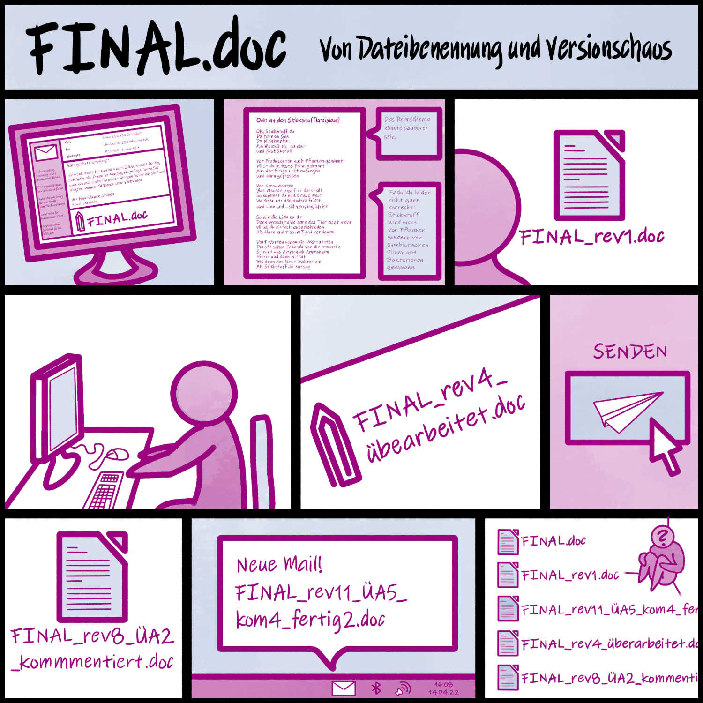</center>

<div style="text-align:center">
<P><SMALL>Illustration: Cleo Michelsen</SMALL></P>
</div>

********************************************************************************

{{1-2}}
********************************************************************************
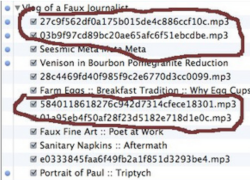

* Haben Sie sich schon mal über sich selbst geärgert, weil Sie bestimmte Dateien nicht oder nur mit großem Aufwand finden konnten?

* Sind Ihnen vielleicht sogar schon mal Daten verloren gegangen, weil Dateien versehentlich überschrieben wurden?

* Gibt es in Ihrem Arbeitsbereich Regeln bzgl. der Benennung von Ordnern und Dateien?

********************************************************************************

{{2}}
********************************************************************************
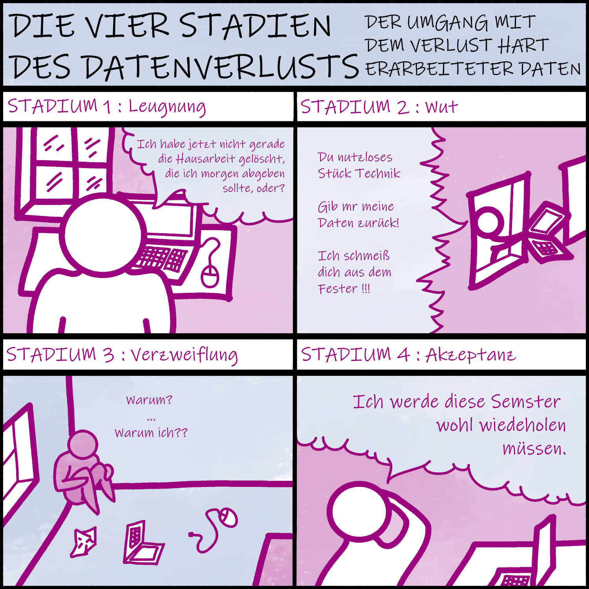

Ordner und Dateien sollten systematisch benannt und geordnet sein, damit

* die Dateien jetzt und in Zukunft leicht auffindbar und zugänglich sind,
* längeres Suchen von Dateien oder das Vergleichen verschiedener Versionen von Dateien vermieden wird,
* Änderungen nachvollziehbar sind,
* die Dateien nicht versehentlich gelöscht oder überschrieben werden,
* um die Zusammenarbeit zu verbessern und
* Automatisierungsprozesse zu ermöglichen.

********************************************************************************

<div style="page-break-after: always;"></div>

## Ordnerstrukturen

Folgende Punkte können bei der Erstellung einer (nachvollziehbaren) Ordnerstruktur helfen:

{{1-9}}
********************************************************************************

* Ordner fassen Dateien mit gemeinsamen Eigenschaften zusammen

  * Mögliche Ordnungskategorien: Projekte, Teilprojekte, Arbeitspakete, Datum oder Zeitraum (z. B. Monate, Quartale), Datentypen (z. B. Text, Abbildungen), Datenanalysen, Literatur, ...
{{2-9}}
* Beschreibende Ordnernamen verweisen auf die Inhalte
{{3-9}}
* Ordner sind hierarchisch strukturiert
{{4-9}}
* Es sind nicht mehr als drei Unterordner angelegt worden
{{5-9}}
* Laufende und abgeschlossene Arbeiten werden getrennt
{{6-9}}
* Rohdaten werden gesondert abgelegt
{{7-9}}
* Es gibt eine Zwischenablage, die regelmäßig aufgeräumt wird -->
{{8-9}}
* Nicht mehr benötigte Dateien werden regelmäßig gelöscht

********************************************************************************

{{9-10}}
********************************************************************************

Es gilt außerdem:

* Prüfen, ob bereits etablierte Strukturen existieren!
* Ausprobieren und anpassen!
* Dokumentieren und Dokumentation bei Änderungen anpassen!
* Für gemeinsam genutzte Dateien gemeinsame Regeln festlegen!
* Konsequent bleiben!

********************************************************************************

<div style="page-break-after: always;"></div>

## Dateibenennung

Die Art und Weise der Benennung von Dateien ist ein wichtiger Baustein im Datenmanagement.

Folgende Punkte können bei der Erstellung (nachvollziehbarer) Dateinamen helfen:

{{1-9}}
* Weniger als 32 Zeichen (besser noch weniger) für Dateinamen benutzen
{{2-9}}
* Grundsätzlich keine unspezifischen Dateinamen (z. B.untitled3746.csv) verwenden
{{3-9}}
* Dateinamen in Namensbestandteilen festlegen, Art der Trennung und Reihenfolge der Namensbestandteile beibehalten (z.B date\_site\_probe0000\_approach.extension)
{{4-9}}
* Grundsätzlich keine Sonderzeichen, Umlaute oder Leerzeichen in Dateinamen benutzen
{{5-9}}
* Einzig erlaubte Sonderzeichen sind Unterstrich ( _ ) und Bindestrich ( - )
{{6-9}}
* Führende Null(en) bei Nummerierungen verwenden
{{7-9}}
* Datumsangaben nach der ISO 8601 (YYYYMMDD oder YYYY-MM-DD oder YYYY\_MM\_DD)
{{8-9}}
* Keine unspezifischen Namensanhänge, wie \_final, \_neu, \_fertig o. ä. verwenden!

{{9-10}}
********************************************************************************

**Es gilt außerdem:**

* Prüfen, ob bereits etablierte Dateibenennungskonventionen existieren.
* Eigene Benennungsregeln in Form einer Dateibenennungskonvention festlegen und dokumentieren.
* Dokumentation der Ordnerstrukturen und Benennungskonventionen inkl. genutzer Abkürzungen u. ä. in einer README-Datei
* Konventionen möglichst frühzeitig festlegen
* Unterschiedliche Konventionen für verschiedene Dateitypen sind erlaubt.
* Dokumentieren/Dokumentation bei Änderungen anpassen

********************************************************************************

{{10}}
********************************************************************************
Beispiele für Benennungskonventionen:

<!-- style="width:120%" -->
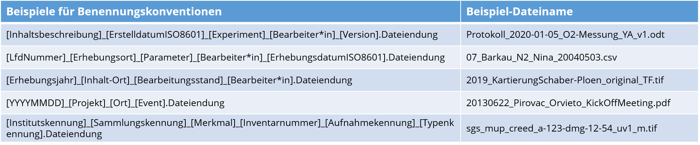

********************************************************************************

<div style="page-break-after: always;"></div>

### Softwaregestützte Dateibenennung
Verschiedene Tools unterstützen das stapelweise Umbenennen von beliebig vielen Dateien und Ordnern in einem Durchgang:

**Windows:**

- Ant Renamer (https://www.antp.be/software/renamer)
- Bulk Rename Utility (https://www.bulkrenameutility.co.uk/)
- Total Commander (https://www.ghisler.com/deutsch.htm)

**Mac:**

- Renamer 6 (for Mac) (https://renamer.com/)
- Name Changer (https://mrrsoftware.com/namechanger/)
- ExifRenamer (https://www.qdev.de/?location=mac/exifrenamer)

**Linux:**

- GNOME Commander (https://gcmd.github.io/)
- GPRename (http://gprename.sourceforge.net/)

**Unix:**

- rename command

<div style="page-break-after: always;"></div>

## Versionierung

{{0-1}}
********************************************************************************

>* Um verschiedene Stadien der Bearbeitung von Dateien nachvollziehen und unterscheiden zu können, sollte eine konsequente Versionierung vorgenommen werden.
>
>* Das Vorgehen bei der Versionierung sollte bekannt sein.
>
>* Versionierungen können im Dateinamen vorgenommen werden und die Vorgehensweise gemeinsam mit der Dokumentation zu Ordnerstruktur und Dateibenennung in der README-Datei dokumentiert werden.
>
>* In einer **Versionskontrolltabelle** kann eine Dokumentation der vorgenommenen Änderungen erfolgen.

********************************************************************************

{{1-2}}
********************************************************************************

**Versionierung im Dateinamen:**

Die Versionierung kann als Bestandteil des Dateinamens definiert werden und dabei zwischen größeren und kleineren Änderungen unterscheiden:

* Beispiel für größere Änderungen = Beispieldatei\_v1 -> Beispieldatei_v2
* Beispiel für kleinere Änderungen = Beispieldatei\_v1-1 -> Beispieldatei\_v1-2
* Beispiel für Major.Minor.Sub-Minor = Beispieldatei\_v0-1-0 -> Beispieldatei\_v0-1-1

><p style="color:#9a047f">**Unspezifische Bezeichnungen möglichst vermeiden!**</p>
>
>* ~original1~
>* ~neu~
>* ~bearbeitung2~
>* ~final~
>* ~final_2~


********************************************************************************

{{2-3}}
********************************************************************************

**Beispiel für eine Versionskontrolltabelle**

| Versionsnr.  | Änderungen                       | Datum      | Bearbeitung durch |
| :----------  | :----------                      | ---        | ---               |
| 1-0          | Freigabe                         | 2023-11-2  | KL                |
| 1-1          | Verbesserung Rechtschreibfehler  | 2023-11-20 | KL                |
| 1-2          | Änderungen am Layout             | 2024-02-20 | GN                |
| 2-0          | Neues Kapitel (3.1) hinzugefügt | 2024-02-26 | GN                |

Eine Versionskontrolltabelle kann innerhalb des bearbeiteten Dokuments oder als separate Datei angelegt werden.

********************************************************************************

<div style="page-break-after: always;"></div>

### Softwaregestützte Versionierung

Es gibt eine Reihe von nützlichen Tools, die ggf. helfen, insbesondere textbasierte Daten und Forschungsdatencode zu verfolgen und zu versionieren.

Die am weitesten verbreiteten basieren auf dem Versionsverwaltungssystem Git und umfassen unter anderem:

* GitHub: https://github.com
* GitLab: https://about.gitlab.com

>Die CAU bietet einen GitLab Dienst: https://cau-git.rz.uni-kiel.de/users/sign_in 

<div style="page-break-after: always;"></div>

## README-Dateien

>**README-Dateien sind wichtige Dokumentationsinstrumente.**
>
>Eine gute README
>
>- reduziert Rückfragen
>- erleichtert Übergaben  
>- schafft Transparenz über Strukturen und Zuständigkeiten
>
>Regeln für das Anlegen von Ordnern und Namenskonventionen können in einer **README-Datei** dokumentiert werden, die als einfache Textdatei (z. B.: .md, .txt) auf der ersten hierarchischen Ebene der jeweiligen Ordnerstruktur abgelegt werden sollte.

## Beispiel README

>Eine solche README-Datei könnte z.B. so aussehen:

<div style="float:left; width:85%;">

```markdown
# ALLGEMEINES
Projekt/Arbeitsbereich: [Bezeichnung des Projekts/Arbeitsbereiches]
Datum: [Datum der Erstellung]
Beschreibung: [Kurze Beschreibung des Projekts/Arbeitsbereiches]
Veranstwortliche: [Namen der Verantwortlichen]
Beteiligte: [Namen der Beteiligten]

Relevante zugehörige Links:
Link zu Univis: [Link]
Link zu OpenOlat: [Link]
Link zu CAUGitLab: [Link]
Link zum FIS: [Link]

# ORDNER
Alle Dateien, die sich auf das Projekt XY beziehen, werden im Ordner 
***[AnyProject]*** gespeichert.

Der Inhalt ist wie folgt in Unterordnern organisiert:

- **Management**: weitere Unterordner: Projektplanung, Finanzmonitoring, Berichte 
- **Meetings**: Präsentationen und Materialien der Projektmeetings, 
Unterordner ggf. nach Datum und Ort geordnet
- **Kommunikation**: Newsletter, Blogbeiträge, etc. 
Unterordner ggf. nach Datum geordnet
- **Rohdaten**: Alle Rohdaten werden in diesem Ordner abgelegt, 
weitere Unterordner sind ggf. nach Datum geordnet
- **AnalyseDaten**: Zu analysierende Datendateien, 
Unterordner ggf. nach Datum geordnet
- **Abbildungen**: Aus Analysedateien erstellte Abbildungen, 
Unterordner ggf. nach Datum geordnet
- **Referenzen**: Bibliothek mit Referenzen
- **AnalogeDokumentation**: Eingescannte Kopien schriftlicher Notizen/Belege
- **Verschiedenes**: Sonstige Informationen, die sich auf dieses Projekt beziehen

# DATEIBENENNUNG
## Management
Die Projektplanungsdokumente werden wie folgt benannt:

Projektkürzel_Planungsteil_Version.Dateiendung
(Beispiel: “AP001_Antrag_V1.docx”, AP001_Zeitplan_V1.docx)

Im Ordner Finanzmonitoring werden Dateien wie folgt benannt:

Projektkürzel_Kostenstelle_Jahr_Monat.Dateiendung
(Beispiel: “AP001_Personal_2023_Januar.docx”)

## Meetings
Die Dokumente zu den Meetings werden wie folgt benannt:

Datum_Ort_Beitrag_Version.Dateiendung
Beispiel: 2024-01-22_Köln_Poster_V1-2.pdf

## Rohdaten
Die Rohdaten-Dateien werden wie folgt benannt:

raw_YYYYMMDD_Gebiet_Object_Zustand.Dateiendung
(Beispiel: “raw_20230701_Bov_KS_2.csv”)

## Analysedaten
Die Dateien der Analysedaten werden wie folgt benannt:

„JJJJMMTT_Gebiet_Objekt_Kondition_Version“
(Beispiel: “20230701_Bov_KS_2_v1-0.csv”)

## Abkürzungen
Für Dateinamen werden folgende **Abkürzungen** verwendet:

*Projektkürzel*: AP001=AnyProject001
*Gebiet*: KI=Kiel, Bov=Bovenau, Emk=Emkendorf
*Objekte*: KS=Klingenschaber, S=Schraube
*Zustand*: 1=vollständig erhalten, 2=teilweise erhalten, 
3=schlecht erhalten/fragmentiert

# VERSIONEN
Versionsinformationen werden in Form einer Major-Minor-Angabe  
im Dateinamen angegeben(_vmajor-minor).

**große Änderungen**: Umfangreiche Korrekturen, Anpassungen oder Ergänzungen 
an einem Datensatz oder einer Textdatei, wie z.B. 
- eine große Anzahl zusätzlicher Einträge in einer Tabelle  
- umfangreiche Bereinigung von Daten 
- Hinzufügung eines Kapitels zu einem Text oder einer Präsentation. 

In diesem Fall erhöht sich die Versionsnummer in Schritten von eins 
(„Major“-Nummer + 1), z. B. von Version 2-0 auf Version 3-0. 
Wird die „Major“-Versionsnummer geändert, muss die „Minor"-Versionsnummer 
wieder von ‚0‘ an aufwärts nummeriert werden (z.B. bei Versionsänderung von 2-4 auf 3-0).

**kleinere Änderungen**: Die Versionsnummer an zweiter Stelle („minor“) 
erhöht sich um +1, wenn kleinere Korrekturen vorgenommen wurden, z. B. die Korrektur von Rechtschreib- und Tippfehlern in Texten oder Tabellen.

# SPEICHERUNG & BACKUP
Alle Dateien werden lokal auf der Festplatte des Computers XYZ gespeichert. 
Ein Backup in in die CAU Cloud und eine extere Festplatte erfolgt [täglich,wöchentlich,...].

# Letzte Änderungen dieser README
| Datum      | Änderung    | Bearbeitet durch |
| :--------- | :---------  | :---------       |
| Datum 1    | Dings 1     | XYZ              |

```
</div>

<div style="page-break-after: always;"></div>

## Zeit für Austausch

>**Gruppenarbeit**
>
>Tauschen Sie sich in Ihren Gruppen zum aktuellen Vorgehen bzgl. Datenmanagement in Ihren jeweiligen Tätigkeitsbereichen aus.
>
>- Existieren in Ihrem Bereich Konventionen zum Umgang mit Daten (z. B. zur Benennung) und/oder bestimmte Routinen, wie z. B. regelmäßiges Aufräumen/Sortieren oder Löschen von Dateien?
>- Welche positiven Erfahrungen können Sie teilen, wie im Arbeitsalltag eine ordentliche und übersichtliche Struktur von Dateien effektiv beibehalten werden kann?

>**Ganz generell**: Wenn Sie an das Handling von Daten in Ihrem jeweiligen Tätigkeitsbereich denken:
>- An welchen Stellen wünschen sich Kolleg:innen oder Forschende Unterstützung von Ihnen?
>- Wo ziehen Sie bewusst eine Grenze und verweisen weiter?

<div style="page-break-after: always;"></div>


# FDM@CAU ✨
<div style="float:right; width:40%;">
  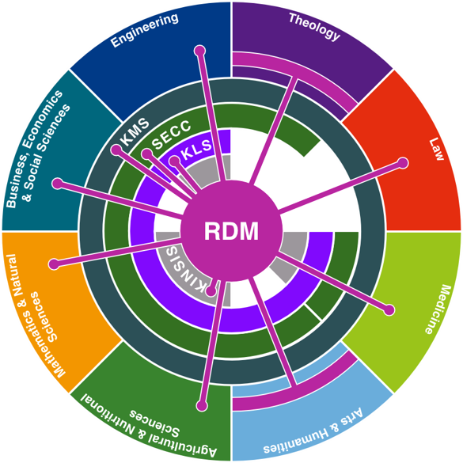
</div>

Das **Zentrale Forschungsdatenmanagement** der CAU besteht aus Mitarbeitenden des Rechenzentrums und der Universitätsbibliothek.

Gemeinsam arbeiten, beraten und unterstützen wir zum Thema.

**Zentrales Forschungsdatenmanagement**

- Kolleg:innen aus RZ und UB für Themen aus FDM, DH, IT und Didaktik

- Entwicklung und Bereitstellung grundlegender Services für FAIR and Open Data

- Beratung und Schulungen für Forschende

- Praktische Unterstützung bei der Realisierung von FDM-Lösungen 

- Didaktische Beratung & Begleitung der Integration von FDM in die curriculare Lehre

- Einrichtung und Betrieb eines institutionelles Datenrepositoriums

Kontakte und Informationen zum FDM an der CAU finden Sie hier: https://www.fdm.uni-kiel.de/

<div style="page-break-after: always;"></div>

## Policies der CAU zu Forschungsdaten

{{0-1}}
****************
>Relevante Leitlinien oder Policies sollten bekannt sein und in jedem DMP genannt werden.
>
>**Sind relevante Leitlinien der CAU bekannt?**

****************

{{1}}
****************
**Relevante Leitlinien der CAU:**

- [Leitlinie zum Umgang mit Forschungsdaten](https://www.datamanagement.uni-kiel.de/de/forschungsdatenmanagement-an-der-cau/leitlinie-zum-umgang-mit-forschungsdaten)

- [Leitlinien zur Förderung von Open Access](https://www.datamanagement.uni-kiel.de/de/forschungsdatenmanagement-an-der-cau/leitlinien-zur-forderung-von-open-access)

- [Richtlinien der CAU zur Sicherung guter wissenschaftlicher Praxis](https://www.uni-kiel.de/fileadmin/user_upload/forschung/integritaet-ethik/downloads/Richtlinien-Sicherung-guter-wissenschaftlicher-Praxis.pdf)

****************

<div style="page-break-after: always;"></div>

## Datenschutz🦺

<iframe src="https://www.uni-kiel.de/gf-praesidium/de/recht/datenschutz-1" style="border:0px;width:100%;height:500px" allowfullscreen="true" webkitallowfullscreen="true" mozallowfullscreen="true"></iframe>

https://www.uni-kiel.de/gf-praesidium/de/recht/datenschutz-1

<div style="page-break-after: always;"></div>

## Opendata@CAU 🔓

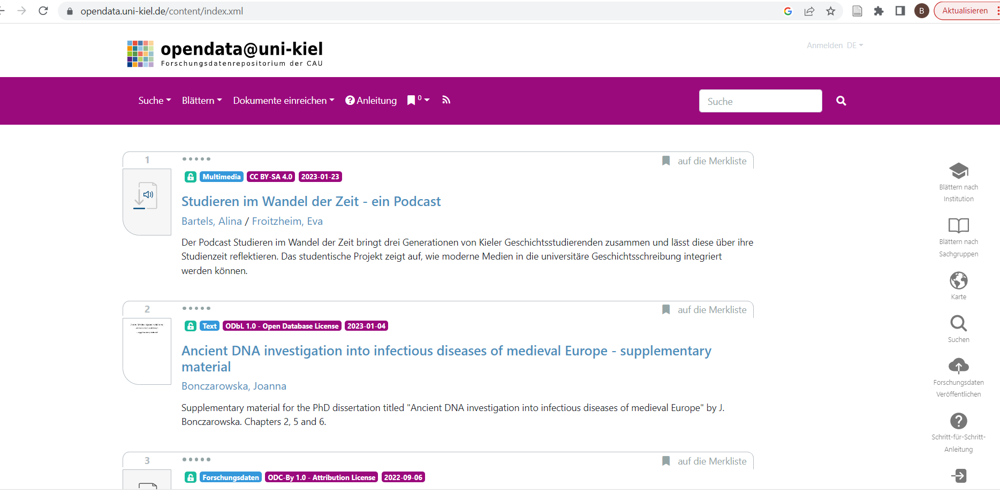

https://opendata.uni-kiel.de/content/index.xml

Testsystem zum Ausprobieren: https://datenrepositorium00.rz.uni-kiel.de

<div style="page-break-after: always;"></div>

## MACAU 📝

<iframe src="https://macau.uni-kiel.de/content/index.xml" style="border:0px;width:100%;height:500px" allowfullscreen="true" webkitallowfullscreen="true" mozallowfullscreen="true"></iframe>

https://macau.uni-kiel.de/content/index.xml

<div style="page-break-after: always;"></div>

## IGSN Dienst 🍃

<iframe src="https://igsn.uni-kiel.de/de" style="border:0px;width:100%;height:500px" allowfullscreen="true" webkitallowfullscreen="true" mozallowfullscreen="true"></iframe>

https://igsn.uni-kiel.de/de

<div style="page-break-after: always;"></div>

## Literaturverwaltung 📚

{{0}}
***
Das Rechenzentrum stellt eine Citavi-Campuslizenz zur Verfügung:

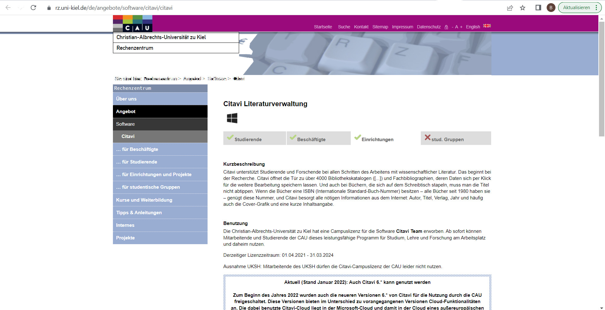

https://www.rz.uni-kiel.de/de/angebote/software/citavi/citavi

***

{{1}}
***
An der Universitätsbibliothek finden Sie Kurse zur Literaturverwaltung sowie verschiedenes Selbstlernmaterial:

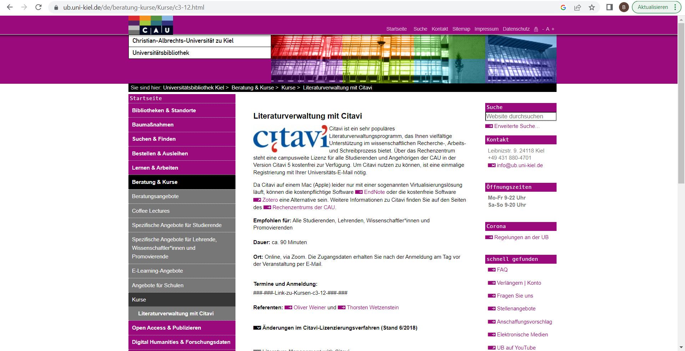

https://www.ub.uni-kiel.de/de/kurse

***

<div style="page-break-after: always;"></div>

## FIS 🔦

<iframe src="https://www.fis.uni-kiel.de/de" style="border:0px;width:100%;height:500px" allowfullscreen="true" webkitallowfullscreen="true" mozallowfullscreen="true"></iframe>


# Feedback

{{0-1}}
********************************************************************************

>Fast geschafft!
>
>Haben Sie noch Fragen oder Anmerkungen?

********************************************************************************

{{1-2}}
********************************************************************************

> <!-- width="100px" align="right" -->
>
>Sie haben heute Abend noch eine Verabredung mit einigen Freunden. Ihre Freunde erinnern sich daran, dass Sie heute an einem Workshop zum Thema Datenmanagement teilgenommen haben und fragen: "Na, wie war's"?
>
>Was antworten Sie?
>

********************************************************************************

{{2}}
********************************************************************************
Das Team FDM der CAU finden Sie hier: https://www.fdm.uni-kiel.de/de


********************************************************************************
<div style="page-break-after: always;"></div>

# Informationen zu diesem Dokument

| Parameter           | Info                       |
| --------            | :------                   |
| Titel:              | @title                     |
| Einsatz:            | @comment                   |
| Autor:innen         | @author                    |
| Lizenz              | @licence                   |
| Link zum Repository:| https://github.com/RDM4CAU |      
